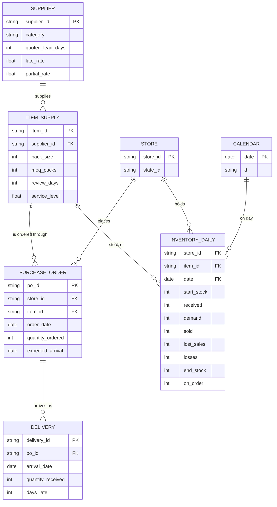

# Retailer Design

## How one day works

The simulated retailer is a small shop that lives day by day inside the computer. Real customer demand comes from M5. Everything on the operations side (stock, orders, deliveries, losses) is simulated by rules. Every day, for every product in every store, the same five steps happen in this order:

1. **Deliveries arrive.** Purchase orders placed earlier reach the store and are added to the stock.
2. **Customers buy.** The M5 units for that day are the demand. The store sells what it has. If the demand is higher than the stock, the shelf empties and the difference is recorded as **lost sales**.
3. **End-of-day losses.** Some stock disappears: food expires, items are stolen or damaged, or a stock count finds a difference.
4. **Stock is recorded.** The closing stock of the day is saved.
5. **Replenishment review.** The store compares its *inventory position* (stock on the shelf + stock already ordered but not yet arrived) with the reorder point **s**. If the position is at or below s, it places a purchase order to bring the position back up to the order-up-to level **S**. The order arrives after the supplier's lead time.

### Example: one product over 5 days

Policy: s = 20, S = 50, lead time = 2 days, reviewed every day. The product starts day 1 with 40 units.

| Day | Start stock | Delivery | Demand (M5) | Sold | Lost sales | Losses | End stock | Review decision |
|---|---|---|---|---|---|---|---|---|
| 1 | 40 | 0 | 15 | 15 | 0 | 0 | 25 | position 25 > 20, no order |
| 2 | 25 | 0 | 8 | 8 | 0 | 0 | 17 | position 17 ≤ 20, **order 33** (to reach 50), arrives day 4 |
| 3 | 17 | 0 | 20 | 17 | **3** | 0 | 0 | position 0 + 33 on order = 33 > 20, no order |
| 4 | 0 | **33** | 10 | 10 | 0 | 1 (expired) | 22 | position 22 > 20, no order |
| 5 | 22 | 0 | 6 | 6 | 0 | 0 | 16 | position 16 ≤ 20, **order 34**, arrives day 7 |

On day 3 customers wanted 20 units but only 17 were on the shelf, so 17 were sold and 3 sales were lost: a stockout. The delivery that fixes it only arrives on day 4, because the order was placed at the end of day 2 with a lead time of 2 days. Lost sales like these are what the stockout model will learn to predict.

### Why do we use the inventory position instead of only the shelf stock?

Because stock that has been ordered is already on its way. On day 3 the shelf is empty, but 33 units are about to arrive. If the store only looked at the shelf, it would order again every day during the lead time, and the deliveries would pile up into a large overstock. The inventory position (shelf + on order) tells the store what it will really have, so it orders once and then waits.

### Why do deliveries arrive before customers buy?

In a real store, deliveries are received in the morning, before or at opening, so the goods are available to customers the same day. If sales came first, a delivery that arrived on the same day would look unavailable and we would record **false stockouts** that never happened. Keeping the order fixed (deliveries, sales, losses, record, review) also makes the simulation easy to explain and to reproduce.

## Losses and stock counts (step 3 of the day)

The shop has two stock numbers. **Physical** is what is on the shelf; customers buy from it. **System** is what the computer believes; the ordering policy uses it.

| Event | Physical | System | Rate |
|---|---|---|---|
| Expiry (FOODS only) | down | down (recorded) | 0.4% of the shelf per day |
| Shrink (theft, damage) | down | unchanged (unseen) | 0.03% of the shelf per day |
| Record error | unchanged | changes by 1 to 3 units | 0.3% of days |
| Count | unchanged | set equal to physical | on an empty shelf with a positive system number, and every 28 days |

Because of shrink and record errors the system number can be wrong for days. This creates "phantom stock": the computer shows stock, the shelf is empty, no order is placed, and customers find nothing. A count corrects it.

## Business rules

All values below are **simulation assumptions**, not real retailer data. They will be stored in `config.yaml` and can be changed.

### 1. Suppliers and lead times

Every product has one supplier, shared by the three stores. There are 10 suppliers, grouped by category.

| Category | Suppliers | Quoted lead time (L) | Late-delivery rate | Why |
|---|---|---|---|---|
| FOODS | 4 | 2 days | 5% to 10% | Perishable goods come from nearby, often and quickly |
| HOUSEHOLD | 3 | 4 days | 10% to 15% | Regular warehouse supply |
| HOBBIES | 3 | 7 days | 15% to 25% | Slower, less reliable, long distance |

The **quoted lead time** is the number of days the supplier promises between order and delivery. The store plans with this number.

### 2. Things that go wrong with deliveries

- **Late deliveries.** With the supplier's late-delivery rate, an order arrives 1 to 4 days later than quoted. The store does not know in advance.
- **Partial deliveries.** On about 5% of deliveries, the supplier sends only 60% to 90% of the quantity. The missing part is cancelled, not delivered later.

Why: if every delivery were perfect, the store's planning would be perfect and there would be almost no stockouts to predict. Late and partial deliveries are the main real-world reason shelves empty even when the store ordered "enough".

### 3. Ordering constraints

| Rule | Value | Meaning |
|---|---|---|
| Pack size | FOODS 6, HOUSEHOLD 12, HOBBIES 4 | A supplier sells only whole packs |
| Minimum order quantity (MOQ) | 2 packs | A supplier will not accept a smaller order |
| Minimum presentation stock | s at least 1 pack, S at least 2 packs | A shop never plans to hold less than a minimum on the shelf |

The order quantity is rounded **up** to whole packs, and is at least the MOQ. The minimum presentation stock also stops a "death spiral": without it, a product that sells nothing for 28 days would get a target stock of 0 and would never be ordered again.

### 4. The baseline ordering policy (s, S)

The store estimates demand from its **recorded sales over the last 28 days**: the mean (μ) and the standard deviation (σ). Then, for each product:

- **Reorder point:** `s = μ × L + z × σ × √L`
- **Order-up-to level:** `S = μ × (L + R) + z × σ × √(L + R)`
- **At each review:** if `inventory position ≤ s`, order `S − inventory position` (rounded up to packs, at least the MOQ).

What the symbols mean:
- **L** is the quoted lead time. **R** is the review period: how often the store checks.
- **μ × L** is the expected demand while waiting for the delivery.
- **z × σ × √L** is the **safety stock**: extra stock as insurance against demand being higher than average. The higher the service level you want, the larger z is.
- **z** depends on the service level: 95% gives z = 1.645, 92% gives 1.405, 90% gives 1.282.

| Category | Review period (R) | Service level | z |
|---|---|---|---|
| FOODS | every day (1) | 95% | 1.645 |
| HOUSEHOLD | every 3 days | 92% | 1.405 |
| HOBBIES | every 7 days | 90% | 1.282 |

Why these choices: fast, perishable food is checked daily and protected the most. Slow hobby items are checked weekly with the lowest protection.

**New products.** Before a product has 7 days of sales history, the store uses the average demand of its department in the same store. When a product first goes on sale, it receives an opening delivery of 14 days of that department-average demand.

### 5. Stock losses

| Loss | Rate | Applies to |
|---|---|---|
| Expiry | about 0.4% of stock per day | FOODS only |
| Shrink (theft, damage) | about 0.03% of stock per day | All products |
| Count corrections | on about 0.3% of products per day, a stock count finds a difference of ±1 to 3 units | All products |

Why: real stock records are never perfectly accurate. These small, random effects make the data realistic and give the models something to deal with.

### 6. What the store can and cannot see

The store sees its own shelf stock, its orders and its recorded sales. It does **not** see lost sales or the true demand. When a shelf is empty, the recorded sales are lower than the demand, so the 28-day average drifts down. This is a known weakness of simple policies (censored demand), and it is one of the reasons why the platform can do better.

## Operational tables

The simulator writes the following tables. Store and calendar come from M5.

| Table | Grain (one row per…) | Purpose |
|---|---|---|
| `supplier` | supplier | Quoted lead time and reliability (late rate, partial rate) |
| `item_supply` | product | Supplier, pack size, MOQ, review period and service level |
| `purchase_order` | order placed (store × product × order date) | What was ordered, when, and when it is expected |
| `delivery` | delivery received | When an order actually arrived, how much, and how late |
| `inventory_daily` | store × product × day | The daily record of the shelf: stock, sales, losses, orders |

`purchase_order` and `delivery` are separate tables because they happen on different days and carry different information: the order records the expectation, the delivery records what really happened (late, partial). This lets us measure supplier reliability.

`inventory_daily` is the main table (about 17.8 million rows). Its column `lost_sales` (demand minus units sold) identifies stockouts: the stockout label used by the prediction model is "`lost_sales` > 0 on any of the next 7 days".

### Entity-relationship diagram

## Time periods

The 5.3 years of data (2011-01-29 to 2016-05-22) are split into blocks so that no model is ever tested on data it has seen.

| Period | Dates | Job |
|---|---|---|
| Burn-in | 2011-01-29 to 2011-02-25 (28 days) | Warm-up: the simulated store builds its first 28-day demand statistics. Not used by any model |
| Block A | 2011-02-26 to 2014-06-30 | Trains the demand forecasting model |
| Gap (7 days) | 2014-07-01 to 2014-07-07 | Purge gap, not used |
| Block B | 2014-07-08 to 2015-06-23 | Trains and validates the stockout model, using out-of-sample demand forecasts |
| Gap (7 days) | 2015-06-24 to 2015-06-30 | Purge gap, not used |
| Live test | 2015-07-01 to 2016-04-30 | Final exam: sealed until the models are frozen |
| Live replay | 2016-05-01 to 2016-05-22 | The day-by-day demo: the platform processes one new day at a time |

### Why this split

- **The demand model is trained only on Block A.** Its forecasts are an input of the stockout model. If the demand model had also seen Block B, its forecasts there would be unrealistically accurate (it would know the answers), and the stockout model would learn to trust forecasts that are far better than real life.
- **7-day gaps.** The forecast looks 7 days ahead, and the stockout label looks at the next 7 days. A row on the last day of a block has a label that depends on days in the next block. The gap removes this overlap, so information cannot leak between blocks.
- **The live test is sealed.** The simulator generates these days in advance, but nobody looks at the results or tunes anything on them until the models are frozen. It is the final exam and is used only once.
- **The live replay is the demo.** After the exam, the platform processes the last 22 days one day at a time, as a real system would.

## Products that are not on sale

A product is "on sale" on a day if it has a price that week (`raw.prices`). A missing price means the store did not sell it (not launched yet, or removed for a while).

- **Not on sale:** the shop holds no stock, places no orders and records no lost sales. If the product leaves the shelf with stock, the stock is cleared and pending orders are cancelled.
- **Launch or return:** an opening delivery of 14 days of the department's average demand (rounded to whole packs). The sales history restarts, and the policy uses the department average until the product has 7 days of its own sales.
- **Limit (department average):** it is computed on the whole history, a small simplification of the simulation.
- **Limit (censored demand):** when a product has a price but sells nothing for a long time (one product had 742 days), we cannot tell whether there was no demand or a hidden stockout at Walmart. We treat these zeros as zero demand.